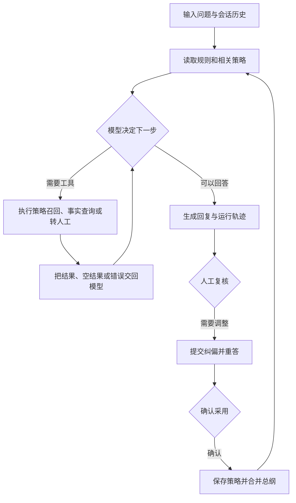

# 知返｜让智能体从反馈里长出下一步

> 一个可运行的个人工程演示项目：验证智能体如何在“观察 → 执行 → 校验 → 纠偏”的循环里工作，并把经过确认的反馈带到下一次任务中。

| 架构 | 目标 | 技术栈 | 阶段 |
| --- | --- | --- | --- |
| 有边界的工具调用循环 | 策略持续演进 | Python、FastAPI、SQLite、大模型 | 可运行原型 |

“知返”取自两件事：工具结果返回上下文，模型据此继续判断；回答被纠正后，经验返回策略库，影响下一次行为。这个项目从 2025 年开始做。我想验证的问题很具体：当任务有未知分支、工具可能失败、规则还会变化时，怎样让智能体继续往前走，同时让人看得清它每一步做了什么。咨询场景只是验证载体，核心是一套可观察、可纠偏、能沉淀经验的运行底座。

## 1. 为什么做这个项目？

最早我试过把模型调用、资料检索和回复串成一条固定流程。问题很快出现：检索没结果，后一步还以为查到了；工具报错，整轮直接中断；一条人工纠正只在当次有效，下次又犯同样的错。往流程里继续加条件分支，能补眼前的洞，却会让系统越来越难维护。

我参考了 Claude Code 的循环思想：模型根据当前上下文决定下一步，系统执行工具，把结果交回模型，再进入下一轮。这里的重点不是“让模型随便发挥”，而是把**决策权、工具能力和停止条件**分清楚。模型选动作，工具给事实，系统守住步数、时间和业务边界。

我还想解决第二个问题：一次反馈怎样真正进入系统。这个项目把人工纠偏拆成“先重答、再确认、后沉淀”，确认后的策略进入可检索记忆。所谓“自进化”，在当前版本里指运行策略和外部记忆的变化，不是模型权重自己更新。

## 2. 技术演进与思考过程

### 第一阶段 · 2025 年初：固定流程走不远

第一版只是接收问题、查资料、拼提示词、生成回答。短问题能跑，遇到资料缺失、工具异常或一句话包含多个意图时就很僵。我一开始以为要写更多提示词，后来发现缺的是下一步决策机制。上下文越堆越长也没有变聪明，只让费用和噪声一起涨。

### 第二阶段 · 2025 年中：把单向链路改成循环

我把运行过程收敛成“给模型当前状态和工具清单 → 模型选择动作 → 系统执行 → 结果回填”。`app/agent/loop.py` 不写具体业务判断，只管理这个协议。未知工具、执行异常和空结果都会成为下一轮可见的观察结果。最大步数和超时负责收尾，防止模型一直在同一个错误里打转。

### 第三阶段 · 2025 年末：从当场修错走向策略沉淀

循环可以修好这一轮，却不一定记住为什么。于是我增加了策略样本：问题、建议回复、判断理由。后来又发现全量样本塞进上下文会稀释重点，便改成按语义召回最相关的几条。硬规则、策略总纲、具体样本分层管理，避免一条新样本冲掉人工明确写下的红线。

### 第四阶段 · 2026 年：让闭环可看、可问、可复核

现在页面能看到模型决策、工具输入输出和最终回复；不满意的回答可以先纠偏重答，确认后再写进策略库；答不上的问题会留下工单。下一步要补的是长会话压缩、自动评测、策略版本回滚和高风险动作校验。这些目前仍是计划，不算已交付能力。

## 3. 架构与闭环



| 模块 | 负责什么 | 为什么这样拆 |
| --- | --- | --- |
|循环引擎 `app/agent/loop.py` | 决策、执行、结果回填、停止 | 不和具体业务绑死 |
| 工具 `app/agent/tools/` | 策略召回、事实查询、案例查询、转人工 | 工具负责做事，不负责替模型决策 |
| 对话服务 `app/services/chat_service.py` | 上下文、规则拼接、纠偏与固化 | 把运行过程和策略管理接起来 |
| 策略服务 `app/services/playbook_service.py` | 样本存储与语义召回 | 每轮只带相关样本，控制上下文噪声 |
| 复盘服务 `app/services/review_service.py` | 工单和指标 | 让失败能回流，而不是消失在日志里 |

## 4. 自进化已经做到哪一步？

当前能做到四件事：人工确认的策略写入 SQLite；相近问题可以召回新策略；策略总纲会合并新原则并保留人工改写；工具错误会回到本轮上下文，供模型决定重试、换路或转人工。

当前还做不到自动证明“新策略一定更好”。也没有自动修改模型权重、自动改代码、无人审批地改写系统规则。把这些边界说清楚，是为了让演示结果经得起追问。

## 5. 工程取舍与踩坑

- **循环怎样停？** 最大步数和超时双重限制；触发后结束本轮并转人工。
- **上下文怎样控量？** 服务时按语义只召回前几条策略；跨轮会话只保留用户消息和最终回复。本轮工具过程保留在运行轨迹里。长会话自动摘要还没做。
- **工具失败怎么办？** 异常包装成结构化结果回填，下一轮模型能看到失败，而不是假设工具成功。
- **事实怎样防编？** 价格、周期等客观信息要求来自事实工具或已确认策略；查不到就转人工。生产使用还需确定性的动作校验。
- **为什么自己写循环？** 我想把模型看见的上下文、工具执行、错误回填和停止条件完整摊开，亲自验证这条链路的边界。现阶段用 FastAPI、SQLite 和单进程会话，换取快速迭代；多租户、审计和高可用尚未覆盖。

## 6. 快速体验

```bash
python3 -m venv .venv
source .venv/bin/activate
pip install -r requirements.txt
python run.py
```

打开 <http://127.0.0.1:8000>。先提一个咨询问题，查看右侧运行轨迹；对回答提交纠偏，确认后保存策略，再用相近问法验证变化。Windows 环境和模型配置见[启动指南](启动指南.md)。

`.env` 中的 `LLM_PROVIDER=ark` 使用火山引擎模型，`LLM_PROVIDER=mock` 使用离线规则桩，两者经过同一套循环。

## 当前边界

这是单机演示项目。会话保存在进程内存中；课程信息和案例是本地样例；尚未接入真实业务系统，也没有自动评测、多租户权限和操作审计。它展示的是一条可运行、可观察、可人工修正的智能体闭环。

## 延伸阅读

- [项目故事与设计思考](docs/项目故事与设计思考.md)：场景、时间线和个人判断
- [智能体运行架构](docs/项目架构解读-AI-Agent.md)：代码分层与运行协议
- [上下文运行设计](docs/上下文管理设计方案-对标ClaudeCode.md)：召回、上下文预算与压缩计划
