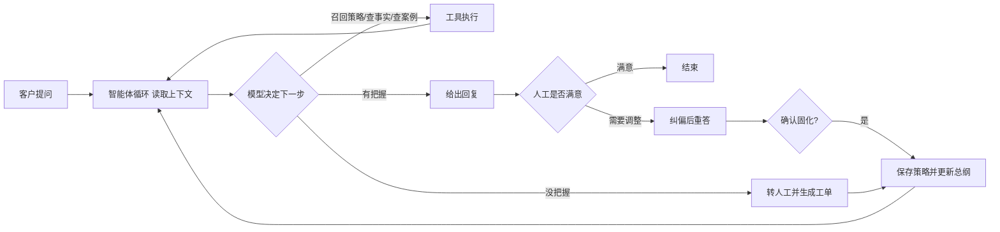

# 知返：项目故事与设计思考

> 这是一个可以打开、可以追问、可以看见内部链路的个人人工智能智能体演示项目。
> 场景数据是为了验证链路准备的本地样例；项目真实发生的是架构探索、交互设计和一次次可复现的验证。

## 我为什么开始做它

2025 年，我开始认真拆解 Claude Code 一类智能体 产品的工作方式。让我感兴趣的不是“模型会调用几个工具”，而是它把工作拆成了一个持续循环：先看当前上下文，再决定下一步；工具执行后，结果重新回到上下文；如果路径不通，错误也成为下一轮判断的依据；循环有步数和时间边界。

我想把这套思想放到一个更接近业务现场的地方。咨询场景是一个合适的切口：客户问“多少钱”“这车能贴改色膜吗”“贴完能保证不起泡吗”，表面像事实题，实际上常常需要先问车型、判断能不能做、选择是否给车主案例，甚至决定什么时候应该转人工。它逼着系统回答一个比“能不能搜到答案”更难的问题：**在当前上下文里，下一句最合适的动作是什么？**

所以我没有把它做成一个 常见问题 页面，也没有先画一张固定流程图。我做的是一个小型咨询工作台：左边模拟一次真实咨询，右边把智能体 的决策和工具结果摊开；后台允许修改规则、处理工单和沉淀策略。这个演示项目的价值不在样例项目本身，而在于把“策略如何进入系统、如何被使用、如何被修正”完整走通。

## 我对人工智能的判断

我希望人工智能是一个可以被带着变好的工作伙伴，而不是一个只能靠发版更新的黑盒。这里的“变好”不是模型权重自动改变，也不是一句“人工智能自进化”就结束，而是三件可检查的事情：

1. 人可以把业务判断写成可复用的策略，而不必改代码或重训模型。
2. 每次回答都能看到它参考了什么、调用了什么、为什么停下来。
3. 一次被确认的纠偏，会改变下一次同类问题的行为。

我把这套思路概括为：**决策交给模型，边界交给系统，经验交给可检索的记忆，人保留最终确认权。**

## 一个具体的业务场景

想象一个做汽车贴膜、改色和车衣的咨询台。渠道带来的咨询每天都在变，一线顾问知道很多隐性的判断：

- 客户问价格时，先问车型和年款，不要一上来把对话变成砍价。
- 客户问“这车能贴吗”时，不直接说可以，要继续问年款和漆面。
- 客户问“能保证不起泡吗”时，不打包票，质保按膜材档位说。
- 资料中没有的价格、工期或质保，不能靠模型猜，应该留下工单并交给顾问确认。

这些判断通常存在一线经验里，散落在聊天记录、运营笔记和口头提醒中。新成员很难一次掌握，机器人也只能背出几条 常见问题。这个演示项目 试着把经验变成一条可演进的链路：先用样本建立基本方向，再通过真实测试纠偏，最后让系统把修正后的经验带到下一次对话里。

## 核心链路：从一次咨询到下一次变化

一条策略样本包含三部分：客户可能怎么问、建议怎么答、为什么这样答。第三部分很重要，因为系统需要学习的是判断原则，而不是死记一句话。样本通过语义召回进入当前上下文，模型再结合对话历史决定是否调用项目检索、车主案例或转人工。

纠偏分成两步：先重答，后固化。这样可以避免一句临时意见直接污染长期策略。工单补录、主动增加样本、对话中确认的纠偏，最后进入同一个策略库；策略总纲会把分散的样本归纳成更短的常驻原则。人工修改过的业务规则优先级最高，避免自动归纳覆盖明确的红线。

## 时间线

### 2025 年上半年：先理解循环，而不是先堆功能

一开始我把智能体 想成“大模型 + 几个工具”。研究 Claude Code 后，我把问题拆成四个验收标准：谁决定下一步、工具如何回填结果、错误如何被看见、循环如何停下来。这个阶段几乎没有页面，主要在确认系统边界：代码不应该偷偷替模型做意图分类，模型应该在结构化工具清单里自己选择动作。

### 2025 年中：第一版是商品咨询

第一版尝试过电商商品咨询：搜商品、查知识、查订单、转人工。它能证明“答不上来以后补资料，下一次可以查到”，但我很快发现它更像一个会更新的 常见问题。客户问价格时，系统依旧倾向于直接报价格，它没有学会“这时候应该怎么接话”。

这次不满意很有价值。它让我把“自进化”的定义收紧：知识会增加不等于策略会变，真正要沉淀的是业务判断。

### 2025 年下半年：切换到贴膜、改色、车衣咨询

我把场景切换到汽车贴膜、改色和车衣，不是因为这个行业更特殊，而是它同时包含策略题、事实题和信心题。系统需要把业务规则、策略样本、项目资料和车主案例分开管理。此时形成了当前的三层结构：业务铁律、策略总纲、按问题召回的具体样本。

我也放弃了独立意图分类器。分类器一旦先做出“问价类/能不能贴类”标签，后面的智能体循环 只是在执行分类结果；分类错了，轨迹也解释不了为什么。让模型根据上下文选择工具，更符合我想验证的智能体 形态。

### 2025 年底：开始处理上下文膨胀

样本少时，把所有样本放进提示词很方便。样本一多，互相冲突的示例会成为噪声，速度和成本也会明显变差。我把服务时的策略读取改为语义 top-k，只带回当前问题最相关的几条；全量样本仍然用于归纳总纲。这个取舍让我更清楚：上下文是预算，不是仓库。

### 2026 年上半年：把纠偏做成可确认的闭环

真实测试中，最有价值的反馈往往不是“再写一条标准答案”，而是“这句话哪里不对”。因此页面上增加了逐条纠偏：写下意见，人工智能当场重答；只有点击确认后，修正后的答案才会进入策略库。工单也沿用同一条沉淀路径，避免出现多个互不相通的知识入口。

### 2026 年中：把它整理成一个可被追问的演示项目

最后我把重点从“功能数量”转到“链路是否说得清”。现在打开项目，使用者可以完成一条完整体验：提出问题、查看轨迹、纠偏、固化、再用近义问法验证变化。代码、文档和页面都围绕这条闭环组织，而不是把它包装成已经上线的客服产品。

## 如果我是企业负责人，我会继续追问什么

### 这是实际业务，还是演示数据？

当前是个人演示项目，贴膜、改色、车衣的价格和车主案例是本地样例，没有接真实 CRM，也没有真实线索量。它真实展示的是智能体循环、工具编排、策略沉淀、可观察轨迹和人工确认闭环。接入真实业务前，还需要替换数据源并建立权限、审计和评测。

###人工智能会不会胡编价格或做出承诺？

系统要求价格、工期、质保等客观信息必须来自检索工具；查不到就转人工。业务规则可以写入“不主动报价”“不承诺不起泡或不褪色”等红线。当前这些仍属于提示词和应用层约束，生产环境还需要对报价、承诺、发送消息等高风险动作增加确定性闸门。

### 策略越来越多之后，会不会失控？

服务时只召回相关 top-k，减少上下文噪声；总纲作为短原则常驻。人工确认的规则优先于自动归纳，纠偏也必须经过确认才入库。下一步需要增加版本管理、冲突检测、离线评测集和回滚能力。

### 真实接入还缺什么？

登录和角色权限、对话持久化、多租户隔离、真实的项目资料和 CRM 接口、敏感信息处理、自动回归评测、操作审计，以及针对高风险动作的人工审批。这些边界我会明确写出来，因为演示项目 的可信度来自知道自己还没有做到哪里。

## 我希望这个项目体现的工作方式

我不把人工智能当成“输入一句话，吐出一句话”的接口，而把它当成一个需要上下文、工具、边界和反馈的系统。一个回答是否好，不只看文案是否流畅，还要看它有没有使用正确的事实、有没有遵守业务红线、有没有在不确定时停下来，以及这次经验能不能被下一次复用。

这也是我做这个项目最想留下的东西：**让人工智能的能力变化有来源、有轨迹、有确认；让业务经验不再只存在于某个人的脑子里；让一个小演示项目 也能诚实地展示从问题出发、到闭环落地、再到下一轮改进的全过程。**

## 当前边界与下一步

- 当前是单机演示项目，无登录和多租户隔离。
- 当前会话存在进程内存，重启后清空；策略库保存在 SQLite。
- 当前样例资料是本地 mock 数据，没有连接真实业务或 CRM 系统。
- 当前没有自动评测集，主要通过页面轨迹和人工复核验证。
- 下一步会优先补充策略版本、评测回归和高风险动作闸门，再考虑接入真实业务数据。
